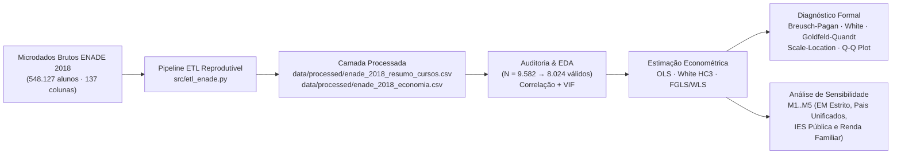
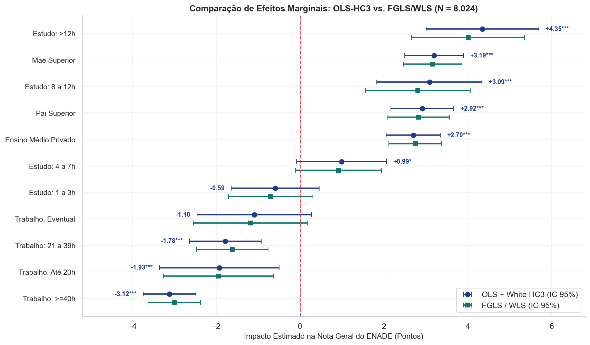
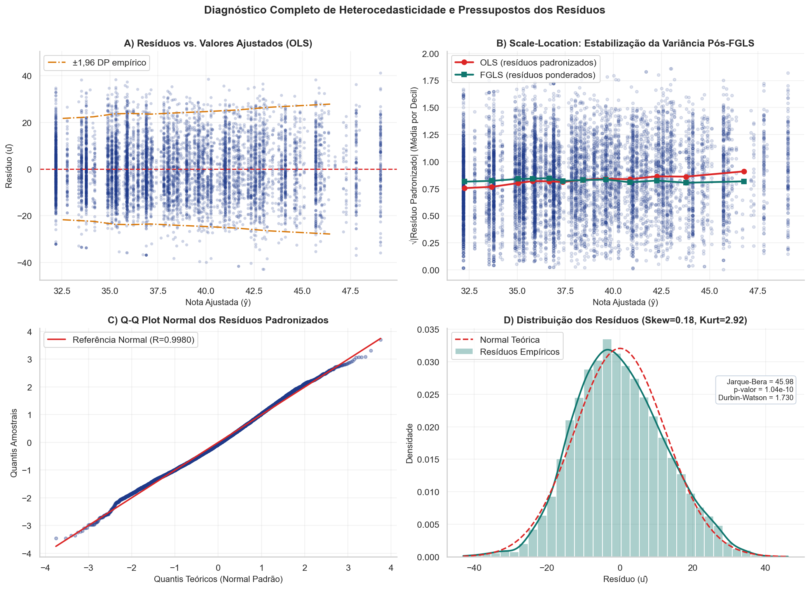
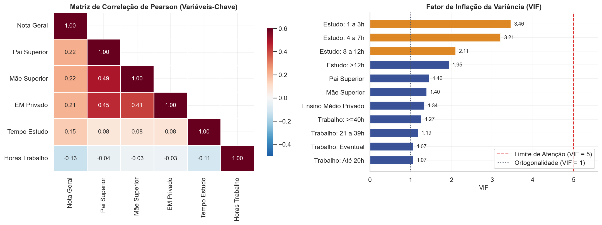
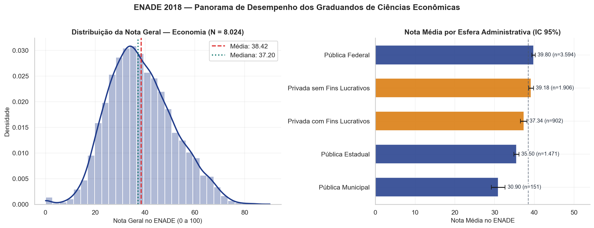
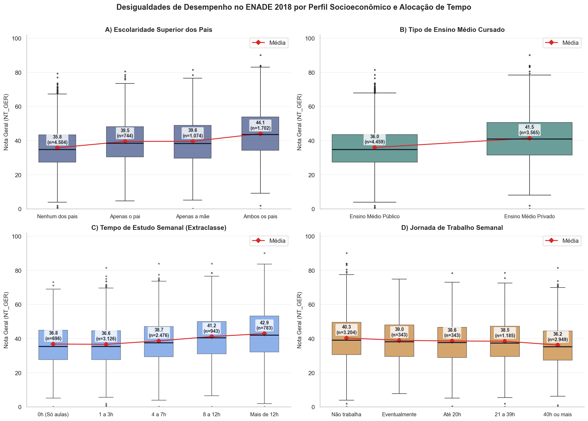

# 📊 Determinantes Socioeconômicos no ENADE 2018 (Ciências Econômicas) — OLS, White `HC3` & FGLS


> **Case de Portfólio em Econometria Aplicada & Ciência de Dados** estruturado com pipeline ETL reprodutível, auditoria de microdados educacionais (INEP), diagnóstico formal de heterocedasticidade/multicolinearidade e notebook executivo completo ([Analise_Econometria_ENADE_2018.ipynb](Analise_Econometria_ENADE_2018.ipynb)).

---

## 🎯 Resumo Executivo (PT-BR)

Este estudo investiga os determinantes socioeconômicos e comportamentais do desempenho acadêmico dos estudantes de **Ciências Econômicas** no **ENADE 2018** (`NT_GER`, escala de 0 a 100), com foco econométrico no **diagnóstico e correção da heterocedasticidade** em dados de corte transversal (*cross-section*).

Partindo da base censitária completa do INEP (**548.127 estudantes** em **27 áreas**, com **462.232 presentes** com nota válida), o estudo isola os **9.582 graduandos de Economia**, aplica um funil auditado de qualidade dos dados até a amostra analítica de **8.024 estudantes** com respostas completas, e compara estimadores **MQO Clássico (`OLS`)**, **MQO com Erros Robustos de White (`OLS-HC3`)** e **Mínimos Quadrados Generalizados Factíveis (`FGLS / WLS`)**.

### Principais Achados Empíricos (`N = 8.024` | Ciências Econômicas)
1. **Capital Cultural Familiar ($H_1$):** No modelo base (`OLS-HC3`), ter pai com ensino superior adiciona **$+2,92$ pontos** ($p < 0,001$) e ter mãe com ensino superior adiciona **$+3,19$ pontos** ($p < 0,001$). Quando ambos possuem graduação, a diferença esperada supera **$+6,11$ pontos** sobre o patamar base (`35,91`).
2. **Formação Básica Prévia ($H_2$):** Egressos do ensino médio privado obtêm **$+2,70$ pontos** a mais ($p < 0,001$) na especificação base. Contudo, ao controlar pela renda familiar na análise de sensibilidade (`M5`), esse prêmio cai para **$+0,93$ pontos** ($p = 0,006$), revelando que grande parte do diferencial bruto do colégio privado refletia renda familiar omitida.
3. **Esforço Extraclasse vs. Restrição de Trabalho ($H_3$):** Dedicar **mais de 12 horas semanais** aos estudos fora de aula eleva a nota em **$+4,35$ pontos** ($p < 0,001$), enquanto trabalhar **40 horas ou mais** reduz a nota esperada em **$-3,12$ pontos** ($p < 0,001$, chegando a **$-4,16$ pontos** quando controlado por renda).
4. **Renda Familiar e Efeito Institucional Oculto:** Sem controle de renda (`M4`), a *dummy* `IES Pública` parece nula ($+0,03$, $p = 0,91$), pois instituições privadas sem fins lucrativos concentram maior parcela de estudantes de alta renda ($30,7\%$ acima de 10 SM vs. $16,0\%$ nas públicas). Ao controlar pela renda familiar (`M5`, $R^2$ sobe de `0,1024` para `0,1321`), a `IES Pública` passa a ter efeito líquido positivo e significativo ($+0,74$, $p = 0,014$), impulsionada pelas **Universidades Federais** (**$+2,28$ pontos**, $p < 0,001$ frente às privadas com fins lucrativos).
5. **Multicolinearidade Descartada e Heterocedasticidade Tratada:** Todos os regressores apresentam **VIF $< 3,5$** (`Pai Superior`: $1,46$; `Mãe Superior`: $1,40$; `EM Privado`: $1,34$). Os testes de Breusch-Pagan ($\text{LM} = 97,49$, $p < 10^{-15}$) e White ($\text{LM} = 145,41$, $p < 10^{-9}$) confirmam heterocedasticidade no OLS; o ajuste **FGLS/WLS** reduz as estatísticas em **63%** e **46%**, respectivamente, e a inferência com **erros robustos `HC3`** assegura validade assintótica.

---

## 🌐 Executive Summary (English)

This project is a reproducible **Applied Econometrics & Data Science case study** examining the socioeconomic drivers of academic performance among **Economics undergraduates** in Brazil's **2018 ENADE** national exam (`NT_GER`, 0–100 scale), focusing on **cross-sectional heteroskedasticity detection and correction**.

- **Reproducible ETL & Data Governance (`src/etl_enade.py`):** Processes the full raw INEP census (`548,127` students across `27` academic fields) into lightweight versioned CSVs (`data/processed/`), enforcing clean missing-value handling prior to dummy encoding (`N = 9,582` Economics enrollees $\to$ `8,073` valid exam scores $\to$ `8,024` complete model observations).
- **Econometric Rigor:** Compares **Classical OLS**, **White Heteroskedasticity-Consistent OLS (`HC3`)**, and **Feasible Generalized Least Squares (`FGLS / WLS`)** using an auxiliary log-variance regression ($\ln \hat{u}_i^2 = X_i \gamma + v_i$), alongside formal **VIF**, **Goldfeld-Quandt** (properly ordered by $\hat{y}$), **Breusch-Pagan-Godfrey**, **White**, **Durbin-Watson**, and **Jarque-Bera** diagnostics.
- **Sensitivity & Institutional Analysis:** Tests five model specifications (`M1`–`M5`), showing how controlling for **household income (`QE_I08`)** resolves compositional confounding between public and private universities ($R^2$: `0.1024` $\to$ `0.1321`, revealing a `+2.28` point net premium for Federal Universities).

---

## 🏗️ Arquitetura do Projeto e Fluxo Econométrico



---

## 📈 Principais Resultados e Visualizações

### 1. Estimação Principal: OLS vs. OLS-HC3 vs. FGLS/WLS (`N = 8.024`)

| Variável Explicativa | OLS Coef | EP Clássico | EP White (`HC3`) | FGLS Coef | EP FGLS |
| :--- | :---: | :---: | :---: | :---: | :---: |
| **Constante** | `35,91***` | `0,50` | `0,50` | `35,98***` | `0,48` |
| **Pai com Ensino Superior** | `+2,92***` | `0,36` | `0,38` | `+2,83***` | `0,38` |
| **Mãe com Ensino Superior** | `+3,19***` | `0,35` | `0,36` | `+3,16***` | `0,36` |
| **Ensino Médio Privado** | `+2,70***` | `0,32` | `0,33` | `+2,75***` | `0,32` |
| **Estudo: 1 a 3h/sem** *(ref: 0h)* | `-0,59` | `0,53` | `0,54` | `-0,70` | `0,52` |
| **Estudo: 4 a 7h/sem** | `+0,99*` | `0,54` | `0,55` | `+0,92*` | `0,52` |
| **Estudo: 8 a 12h/sem** | `+3,09***` | `0,63` | `0,64` | `+2,81***` | `0,64` |
| **Estudo: >12h/sem** | `+4,35***` | `0,65` | `0,69` | `+4,01***` | `0,69` |
| **Trabalho: Eventual** *(ref: não trabalha)* | `-1,10` | `0,71` | `0,70` | `-1,18*` | `0,70` |
| **Trabalho: Até 20h/sem** | `-1,93***` | `0,71` | `0,73` | `-1,95***` | `0,67` |
| **Trabalho: 21 a 39h/sem** | `-1,78***` | `0,43` | `0,44` | `-1,62***` | `0,44` |
| **Trabalho: $\ge$40h/sem** | `-3,12***` | `0,32` | `0,32` | `-3,00***` | `0,32` |
| **$R^2$ / $R^2$ Ajustado** | `0,1024 / 0,1012` | — | — | `0,0909 / 0,0896` | — |

*Níveis de significância: `***` $p < 0,01$; `**` $p < 0,05$; `*` $p < 0,10$.*

<p align="center">
  
</p>

---

### 2. Diagnóstico de Heterocedasticidade e Multicolinearidade

| Teste Diagnóstico | OLS (Resíduos Brutos) | FGLS/WLS (Resíduos Ponderados) | Leitura Metodológica |
| :--- | :---: | :---: | :--- |
| **Goldfeld-Quandt** *(ordenado por $\hat{y}$, drop 20%)* | $F = 1,3236$ ($p < 0,0001$) | $F = 0,8374$ ($p = 1,0000$) | Rejeita variância constante crescente no OLS e estabiliza no FGLS |
| **Breusch-Pagan-Godfrey (LM)** | $97,49$ ($p = 5,59 \times 10^{-16}$) | $36,17$ ($p = 0,0002$) | Redução de **63%** na estatística LM após ponderação FGLS |
| **White (LM com termos cruzados)** | $145,41$ ($p = 2,55 \times 10^{-10}$) | $78,77$ ($p = 0,0156$) | Redução de **46%** na estatística LM (não rejeita a 1%) |

<p align="center">
  
</p>

<p align="center">
  
</p>

---

### 3. Distribuição das Notas e Análise Exploratória

<p align="center">
  
</p>

<p align="center">
  
</p>

---

## 📂 Estrutura do Repositório

```text
├── Analise_Econometria_ENADE_2018.ipynb   # Notebook único executivo (narrativa teórica, código, gráficos e tabelas)
├── README.md                              # Documentação executiva do projeto (PT-BR e EN)
├── requirements.txt                       # Dependências Python do projeto
├── .gitignore                             # Exclusão de arquivos brutos temporários (.txt, .rar, .zip)
├── src/
│   └── etl_enade.py                       # Pipeline ETL reprodutível (extrai e processa microdados do ENADE 2018)
├── assets/                                # Gráficos exportados em alta resolução (PNG)
│   ├── 01_distribuicao_notas_economia.png
│   ├── 02_painel_socioeconomico_boxplots.png
│   ├── 03_correlacao_e_vif.png
│   ├── 04_forest_plot_coeficientes.png
│   └── 05_diagnostico_residuos.png
└── data/
    ├── reference/
    │   └── Dicionario_Variaveis_ENADE_2018.xlsx
    └── processed/
        ├── enade_2018_resumo_cursos.csv   # Estatísticas nacionais agregadas (548.127 alunos / 27 áreas)
        └── enade_2018_economia.csv        # Base tratada de Ciências Econômicas (9.582 inscritos / 8.024 válidos)
```

---

## 🚀 Como Executar Localmente

1. **Clonar o repositório e instalar as dependências:**
   ```bash
   pip install -r requirements.txt
   ```

2. **(Opcional) Reexecutar o pipeline ETL a partir dos microdados brutos:**
   ```bash
   python src/etl_enade.py
   ```
   *(Os dados tratados já estão versionados em `data/processed/` para execução imediata do notebook).*

3. **Abrir e executar o notebook:**
   ```bash
   jupyter notebook Analise_Econometria_ENADE_2018.ipynb
   ```
